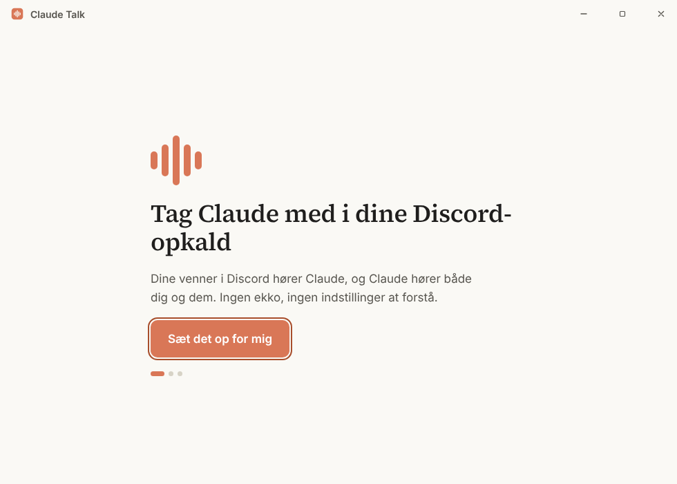
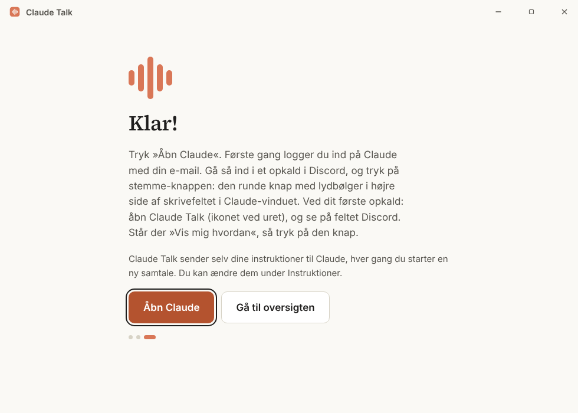

# Claude Talk

**Tag Claude med i dine Discord-opkald.** De andre i opkaldet hører Claude, og Claude hører både dig og dem. Intet ekko, ingen indstillinger at forstå.

## Sådan kommer du i gang

Du skal bruge Windows 11, Discord-programmet på din pc (ikke Discord i browseren eller på mobilen) og en Claude-konto (opret den på claude.ai).

**1. Hent programmet.** Tryk her: [Hent Claude Talk](https://github.com/clark-nielsen-gif/Claude-talk/releases/latest/download/ClaudeTalk-Setup.exe). Filen lander i din Overførsler-mappe. Siger din browser, at filen ikke hentes ofte, så vælg **Behold** (i Edge: de tre prikker ved filen → **Behold** → **Vis mere** → **Behold alligevel**).

**2. Installer.** Dobbeltklik på filen. Siger Windows »Windows har beskyttet din pc«, så tryk på **Flere oplysninger** og derefter **Kør alligevel** (se længere nede, hvorfor). Windows spørger så én gang, om programmet må ændre din pc. Boksen er gul og siger »Ukendt udgiver«. Det er normalt for Claude Talk. Tryk **Ja**. Tryk **Installer**, vent lidt, og tryk **Udfør**. Installationen henter selv Claude Talk-mikrofonen, så der skal være internet i et øjeblik. Bagefter finder du Claude Talk i Start-menuen.

**3. Tryk på knappen.** Claude Talk åbner. Tryk **Sæt det op for mig**, og derefter **Åbn Claude**. Log ind på Claude med din e-mail (kun første gang, se herunder). Start et opkald i Discord. Tryk så på stemme-knappen i Claude-vinduet: den runde knap med lydbølger i højre side af skrivefeltet.

| Første gang | Klar |
|---|---|
|  |  |

### Hvorfor siger Windows »Windows har beskyttet din pc«?
Det sker, fordi programmet er nyt, og Windows ikke kender det endnu. Det er sikkert at fortsætte:
1. Tryk på **Flere oplysninger** (den lille tekst i den blå boks).
2. Tryk på knappen **Kør alligevel**, der dukker op nederst.

### Hvis Windows siger »Smart App Control har blokeret en app«
Nogle nye pc'er har Smart App Control slået til. Den stopper programmer, der endnu ikke er signeret af en kendt udgiver, og den kan ikke tilsidesættes for ét program. Claude Talk er ikke signeret endnu, så på de pc'er kan det ikke installeres, før det er signeret (se `SIGNING.md`).

## Det skal du vide
- **Claude kører i sit eget vindue i Claude Talk.** Det er det, der gør, at Claude kan høre dig og Discord, uden at noget andet på din pc kommer med. Du logger ind én gang, og så husker vinduet det.
- **Log ind med din e-mail.** Google tillader ikke login i programmers egne vinduer. Skriv din e-mail, og tryk på knappen under feltet (den hedder »Continue with email«). Claude sender dig en mail med en kode. Skriv koden i Claude-vinduet. Tryk ikke på linket i mailen: så logger du ind i din almindelige browser i stedet.
- **Discord bruger Claude Talk-mikrofonen**, når Discords inputenhed står på »Standard« (det gør den normalt). Claude Talk sætter det selv op, og din stemme går stadig igennem som før. Lad derfor Claude Talk køre (den starter med Windows og ligger nede ved uret). Lukker du Claude Talk, får Discord din almindelige mikrofon tilbage. Er du midt i et opkald, spørger Claude Talk først, om Discord skal genstartes, så de andre stadig kan høre dig.
- **Brug gerne høretelefoner.** Med højttalere slår Claude Talk selv ekkodæmpning til, men høretelefoner giver den bedste lyd.
- Programmet kræver **Windows 11**.

## Spørgsmål og svar

**Hører Claude sig selv?** Nej. Claude får kun din mikrofon og Discord, aldrig sin egen stemme. Discord får din mikrofon og Claude, aldrig sig selv.

**Kan jeg gøre Claude stille i Discord uden at lukke noget?** Ja. Tryk **Gør Claude stille** på Claude-kortet, eller brug **Ctrl+Shift+F9**. **Ctrl+Shift+F10** slår din egen mikrofon fra og til.

**Kan jeg bruge Claude i Chrome eller Claude-appen i stedet?** Som udgangspunkt nej: Claude Talk bruger sit eget Claude-vindue, så Claude kun hører det, den skal. Har du selv installeret et ekstra virtuelt lydkabel (VB-CABLE A, B, C, D eller Hi-Fi Cable), kan det slås til under **Avanceret**. VoiceMeeter kan ikke bruges til det.

**Hvad sker der med mine samtaler og min adgangskode?** Claude Talk ser dem aldrig. Du logger ind direkte på Claudes egen side (claude.ai). Claude Talk læser aldrig adgangskoder, koder eller cookies.

**Kan Claude kun svare, når nogen siger »Claude«?** Ja. Gå til **Instruktioner**, og slå »Svar kun, når nogen siger et bestemt ord« til. Du kan vælge et andet ord, bede Claude svare kort, tale dansk eller skrive dine egne instruktioner, f.eks. »Du er spilleder i vores rollespil«. Claude Talk skriver dem selv til Claude som første besked, hver gang du starter en ny samtale. Vil du have, at Claude slet ikke hører de andre i opkaldet, så slå »Claude hører de andre i opkaldet« fra.

**Claude svarer ikke.** Se i feltet med overskriften **Claude** i Claude Talk. Står der »Tryk på den runde knap med lydbølger …«, så tryk **Vis Claude-vinduet** og tryk på den knap. Har du slået »Svar kun, når nogen siger et bestemt ord« til under **Instruktioner**, svarer Claude kun, når nogen siger ordet. Står der en besked på engelsk i Claude-vinduet, f.eks. at du har brugt dine beskeder for nu, så kan Claude først svare senere. Det er Claude, ikke Claude Talk, der sætter grænsen.

**Jeg har lukket vinduet. Kører Claude Talk stadig?** Ja. Når du lukker vinduet, lægger Claude Talk sig nede ved uret (tryk på den lille pil ^ ved uret, hvis du ikke kan se ikonet, eller åbn Claude Talk fra Start-menuen). Klik på ikonet for at åbne det igen. Vil du lukke helt, så højreklik på ikonet og vælg **Luk Claude Talk**.

**De andre kan ikke høre Claude.** Se i feltet med overskriften **Discord** i Claude Talk. Står der et grønt flueben ved »De andre i Discord hører Claude«, så se i Claude-vinduet, om Claude taler (lydbølgerne bevæger sig). Ellers følg knappen i feltet.

**Hvordan fjerner jeg det igen?** Åbn **Indstillinger → Apps → Installerede apps**, tryk på **…** ved Claude Talk og vælg **Afinstaller**. Svar **Ja**, når Windows spørger. Discord får sin almindelige mikrofon tilbage, og Claude Talk-mikrofonen fjernes. Undervejs bliver du spurgt, om du også vil slette dine indstillinger og logge ud af Claude i Claude Talk.

## Fejlfinding

| Det ser du | Det gør du |
|---|---|
| »Discord bruger en anden mikrofon« | Tryk **Vis mig hvordan**, og vælg **Standard** som inputenhed i Discord (ikke en bestemt mikrofon). Fluebenet kommer af sig selv. |
| »Discord skal lige genstartes« | Tryk **Genstart Discord for mig**. |
| »Windows blokerer din mikrofon« | Tryk **Åbn mikrofonindstillinger**, og slå »Adgang til mikrofon« og »Giv skrivebordsapps adgang til din mikrofon« til. |
| »Vi kan ikke finde en mikrofon« | Sæt dit headset i. Claude Talk finder det selv. |
| »Tryk på den runde knap med lydbølger …« | Tryk **Vis Claude-vinduet**, og tryk på den knap i skrivefeltet. |
| »Din mikrofon er slået fra …« | Tryk **Slå min mikrofon til** i feltet **Dig**. |
| Claudes stemme er svag i Discord | Slå Discords støjfjernelse fra under *Stemme og video*. |
| Noget andet driller | **Hjælp → Kør selvtest** (når du ikke er i et opkald). Hjælper det ikke, så **Hjælp → Gem fejlrapport** og **Skriv til os**. |

## Om
Claude Talk er et uafhængigt open source-projekt (MIT) og er ikke lavet af Anthropic eller Discord.

Claude Talk-mikrofonen er VB-CABLE fra VB-Audio, som installeren henter direkte fra vb-audio.com. Støt gerne VB-Audio, hvis du bruger den.

Teknisk dokumentation: `PLAN.md`, `DECISIONS.md`, `KNOWN_ISSUES.md`, `PROGRESS.md`, `SIGNING.md`, `MANUAL_TEST.md`.
